  

  <b>Junior Web Developer</b> &nbsp;·&nbsp; Frontend &nbsp;·&nbsp; Backend &nbsp;·&nbsp; Mobile

  I build clean, responsive web and mobile apps, from the UI to the database.

 

<h2 align="center">🚀 About Me</h2>

  🌐 <b>Frontend</b> &nbsp;—&nbsp; React, Next.js, TypeScript, Tailwind CSS, HTML, CSS 
  ⚙️ <b>Backend</b> &nbsp;—&nbsp; Node.js, NestJS, Python, PostgreSQL, Supabase 
  📱 <b>Mobile</b> &nbsp;—&nbsp; Flutter, Dart, Android 
  🎨 <b>Design</b> &nbsp;—&nbsp; Figma to real, working interfaces

  <i>Always learning, one commit at a time.</i>

 

<h2 align="center">💻 Tech Stack</h2>

  

  
  
  
  
  

 

<h2 align="center">📊 GitHub Stats</h2>

  
  

  

 

<h2 align="center">🤝 Connect</h2>

  
  
  

