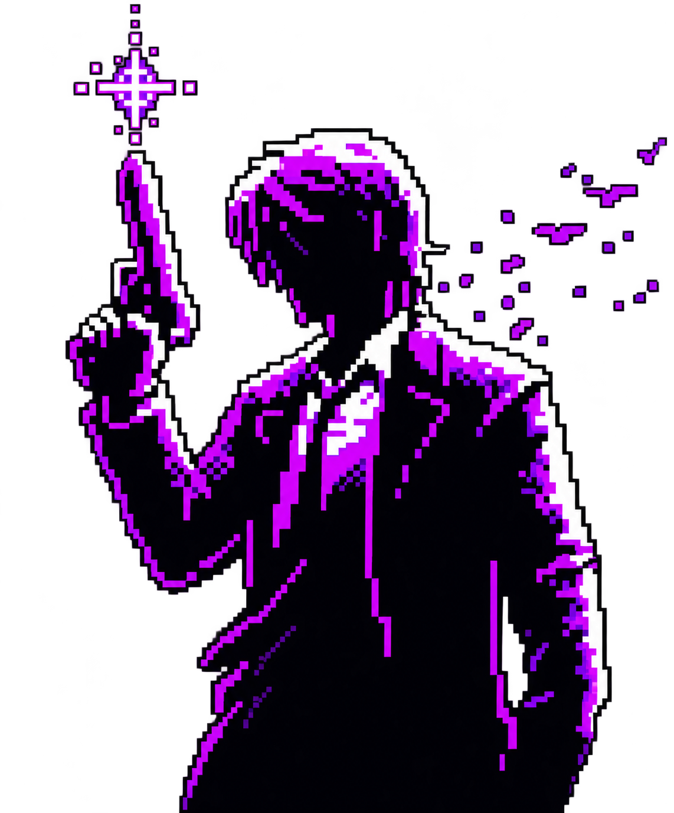

  

  <b>Junior Web Developer</b> &nbsp;·&nbsp; Frontend &nbsp;·&nbsp; Backend &nbsp;·&nbsp; Mobile

  I build clean, responsive web and mobile apps, from the UI to the database.

 

<h2 align="center">About Me</h2>

<table width="100%">
  <tr>
    <td width="60%" valign="middle">
      

        Hi, I'm Hamzah a junior developer who loves building things for the web and mobile.
      

      

        I work with <b>React</b>, <b>Next.js</b>, <b>NestJS</b>, and <b>Flutter</b>, 
        and I'm learning something new with every project I ship.
      

    </td>
    <td width="40%" align="center" valign="middle">
      
    </td>
  </tr>
</table>

 

<h2 align="center">Tech Stack</h2>

  

  
  
  
  
  

 

<h2 align="center">Connect</h2>

  
  
  

